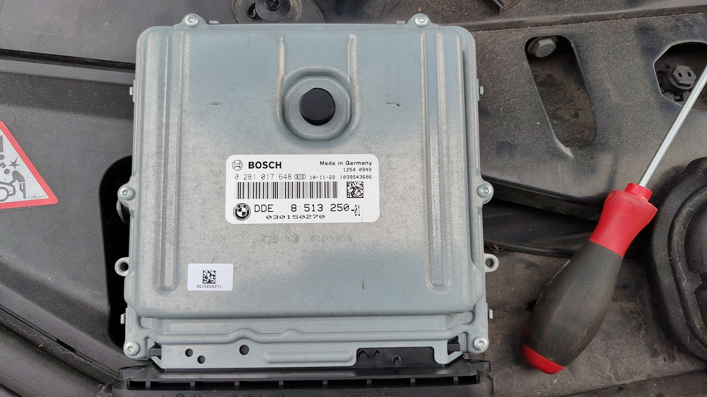

# BMW-F11-EV-Conversion

Documenting the electronics and software side of converting a 2011 BMW 520d F11 (VIN: WBAMX12080V788571) to fully electric drive using a GS450h gearbox/inverter and ZombieVerter VCU.

## Project Goal – DDE FlexRay Emulator

The DDE (Diesel Engine Electronics) on this F11 talks to the rest of the car primarily over FlexRay. Once the diesel engine is removed, the cluster, gateway and other modules still expect to see a living DDE on the FlexRay network.

The plan is to build a small emulator that:

- Speaks FlexRay to the car (two channels)
- Speaks CAN to the ZombieVerter VCU
- Translates the essential signals (RPM, coolant temp, fuel rate / power, status bits, etc.) so the car continues to behave normally
- Provides USB for programming and logging

Hardware target: two FlexRay channels + one CAN channel + USB.  
Bench development is being done with OpenFSD FlexRayRPIPanda boards and software based on dynm/pico-flexray, with SavvyCAN (flexray-phase1-capture branch) for capture and analysis.

## The DDE

- **BMW part number**: 8 513 250-01  
- **Bosch number**: 0 281 017 648  
- **Engine**: N47T 2.0 L diesel (520d)

FlexRay captures (ignition-on and engine start/stop) and later MITM logs are being used to reverse-engineer the frames the DDE sends and receives.

## FlexRay Capture Hardware / Software

- Hardware base: https://github.com/dynm/pico-flexray  
- SavvyCAN FlexRay branch: https://github.com/Tom-evnut/SavvyCAN/tree/flexray-phase1-capture  

Logs live in the `Logs/FlexRay` folder.
